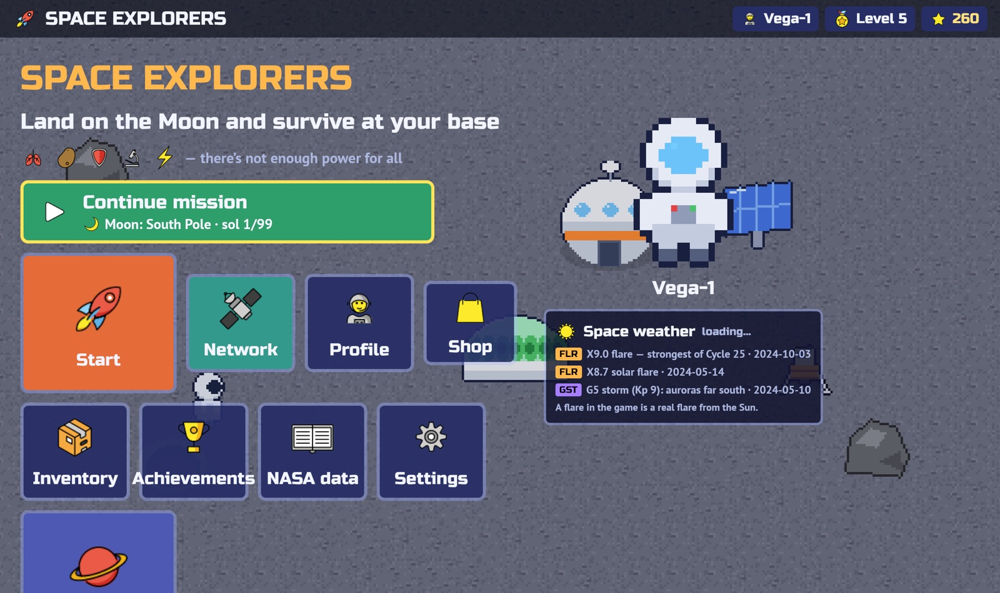
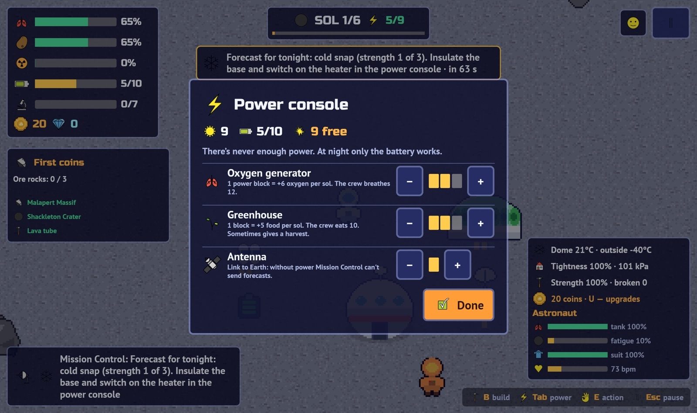
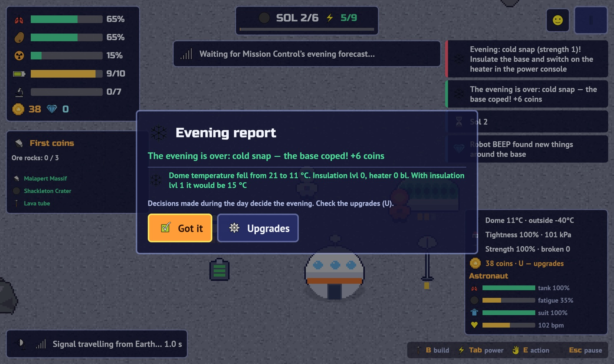
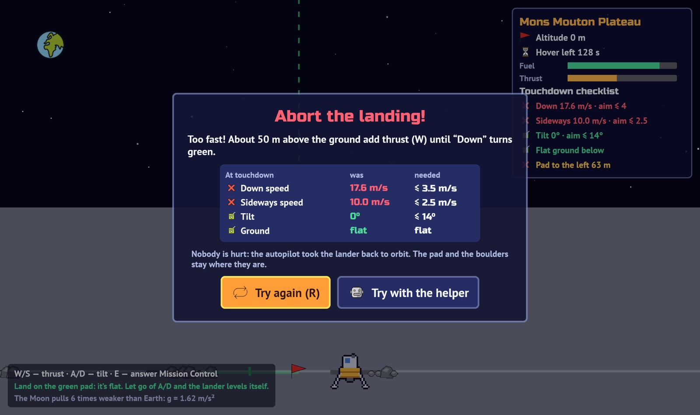
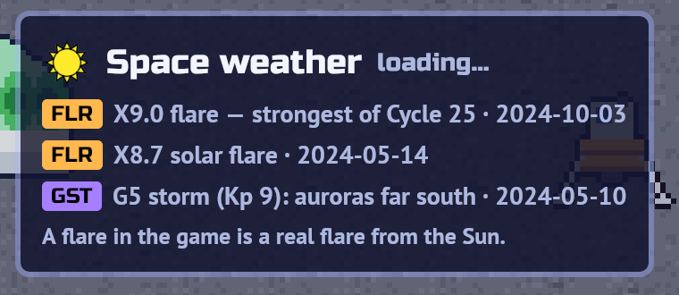

# 🚀 SPACE EXPLORERS

**NASA Space Apps Challenge 2026 — “Build a Junior Astronaut Mission Trainer”**
**Team MilkyWay Kazakhstan**

SPACE EXPLORERS is an interactive educational game that introduces kids aged 7–12 to space and builds the skills future astronauts need. Players fly a spacecraft, complete tasks, land on the Moon and keep a base alive, in a **story mode** and a **survival mode**. Through game situations we train concentration, logical thinking, fast decision-making, coordination and teamwork — and every choice costs something, just like in a real mission.

📑 **Presentation:** [docs/presentation/SPACE_EXPLORERS_SpaceApps2026.pdf](docs/presentation/SPACE_EXPLORERS_SpaceApps2026.pdf) (7 slides) · [where each claim comes from](docs/presentation/README.md)



| | |
|---|---|
|  |  |
|  |  |

## ▶️ How to run

1. Install Rust: https://rustup.rs
2. **Windows:** install [Visual Studio Build Tools](https://visualstudio.microsoft.com/visual-cpp-build-tools/) with the **“Desktop development with C++”** workload (Rust needs its linker).
   **Linux:** `sudo apt install libasound2-dev libudev-dev pkg-config`. **macOS:** `xcode-select --install`.
3. In the project folder:

```bash
cargo run --release
```

This starts SPACE EXPLORERS (`crates/game`). The first build takes about 10 minutes (Bevy is big); later builds are incremental.

**NASA API key (optional):** without a key the game uses `DEMO_KEY`, which allows only ~30 requests per hour per IP. For demos and judging, get a free key at https://api.nasa.gov and start the game with it:

```bash
NASA_API_KEY=your_key cargo run --release
```

On Windows PowerShell: `$env:NASA_API_KEY="your_key"; cargo run --release`. With no internet the game uses its built-in archive of real DONKI events and labels it as archive on screen.

## 🎮 One mission, three acts

**1. Fly the ship (story mode).** A 2-day flight to the Moon on the ship *Aurora* (shortened for play — Apollo crews took about 3 days). Crew dialogues, physics cards, asteroid alerts and **23 mini-games** at the ship’s consoles: engine burns, wiring, finding leaks, meals and more.

**2. Land it yourself.** Thrust (W/S) and tilt (A/D) in real lunar gravity, **1.62 m/s²**. A green pad marks the flattest ground and a live checklist turns each touchdown rule green or red (down speed, sideways speed, tilt, flat ground). E answers Mission Control’s “1202” alarm. A bad landing aborts safely back to orbit, and a **“was / needed”** table shows what to fix; **R** or “Try with the helper” starts a new approach.

**3. Keep the base alive (survival mode)** near the lunar south pole. Every morning Mission Control sends tonight’s forecast — cold snap, dust, meteorites, energy crisis, breakdowns or a **real NASA DONKI solar event**. During the day you work, build and buy upgrades with coins; in the evening the threat hits; then an **evening report** explains what your choices changed.

There is also a **creative mode** (a sandbox with no drain) for building freely.

**Base controls:** WASD move · E action · Tab power console · B build · U upgrades · Esc pause. Gamepad and touch controls are supported too.

## ⚖️ No choice is free

The power console splits a few blocks of sunlight a sol between life support and everything else. The numbers on screen are real game rules:

- **Oxygen:** 1 power block gives +6 a sol, but the crew breathes 12.
- **Food:** 1 block gives +5 a sol, but the crew eats 10.
- **Antenna:** without power Mission Control can’t send the forecast — and even with power the signal from Earth takes **1.3 s**.
- **Heat:** in one cold snap the dome fell from 21 °C to 11 °C; the report says that with insulation level 1 it would have been 15 °C.
- **Radiation:** a shield module and the dome protect the crew; dose is tracked against a limit.

How much sunlight you get depends on the landing site, dust on the panels and the time of day — at night only the battery works.

## 🛰️ NASA data used and why

| Source | What it does in the game |
|---|---|
| **NASA DONKI** (FLR, GST, SEP, CME), live via api.nasa.gov | Real flares, geomagnetic storms, particle events and CMEs become evening threats. Each names its real event and date and is marked *LIVE* or *archive*. |
| **Curiosity RAD** — Mars surface 0.64 mSv/day (Hassler et al., 2014) | Radiation dose ratios between places |
| **Chang’e‑4 LND** — lunar surface 1.369 mSv/day (Zhang et al., 2020) | Moon dose rate: about 2× Mars |
| **NASA Veggie** | The greenhouse, like the lettuce astronauts ate on the ISS in 2015 |
| **NASA LCROSS** | Why the base is at the south pole: water ice (2009) |
| **NASA Space Communications** | Mission Control delay: 1.3 s from the Moon |
| **NASA-STD-3001**, NASA HRP | Why radiation dose has a limit (600 mSv career limit) |

Every source is listed on the in-game **“NASA data”** screen.

**Honesty rules in the code:**
- Game numbers are scaled so kids can follow them; ratios and cause and effect follow the real data.
- Archived data is **never** shown as live.
- Game conventions (asteroids on the way to the Moon, a lunar “dust” threat) are game conventions, not claims about real hazards.

## 👩‍🚀 Multiplayer

- **2 players on one computer.**
- **Up to 4 computers on the same Wi‑Fi:** one player chooses **Network → Create a game** and gets a 4-digit room code; friends join with the code (or the host’s IP if the school Wi‑Fi blocks broadcasts). Works on the ship and on the Moon. No internet and no server needed — plain UDP on ports 7777 and 7778 (allow them if Windows asks).
- **Crew roles:** pilot (+20% landing fuel), engineer (repairs ×1.5), researcher (+25% science), life support (suit oxygen drains 25% slower). A role gives a bonus and forbids nothing.
- Online chat uses **quick phrases only**.

## 🛡️ Safe for kids

- **Nobody dies.** A bad landing returns to orbit; a lost base ends in a safe evacuation and a debrief with an “if–then” tip.
- **No accounts, no personal data.** Up to 6 profiles per computer; the name is a callsign picked from a list (Vega‑7, Orion‑4…). Everything stays in a local JSON file.
- **No real money.** Stars buy cosmetics only.
- **Two levels:** Junior (7–9, icons first, gentler numbers) and Advanced (10–12).
- **Languages:** English and Russian; Kazakh is in beta (`assets/content/ui.json`, still needs a native-speaker check — missing keys fall back to Russian).

## 🧠 Psychology

Based on our team’s research on preparing young astronauts:
- An **if–then plan** (“If there is a flare — then I run into the dome”).
- A **calm-breathing** action that lowers the astronaut’s heart rate, and a voluntary breathing pause (Obradović et al., 2021).
- **Crew support** moments: notice how a crewmate feels and help.
- **Feedback describes actions**, not personality; a debrief after every mission.

## 🧪 Balance test

Automated players run 300 Moon survival missions for each level and play style (1,200 in total): a careful player who follows the forecast, and a careless one who ignores it.

```bash
cargo test -p ja-core --release survival_balance -- --ignored --nocapture
```

| Level | Careful: win % | Careless: win % |
|---|---|---|
| Junior | 100 | 0 |
| Advanced | 100 (299 / 300) | 0 |

Preparation decides the outcome. The full test suite: `cargo test --release --workspace`.

## 🏆 How we address the judging criteria

- **Impact:** for kids 7–12; icon-first UI, two levels, keyboard / gamepad / touch, works offline, multiplayer for classrooms.
- **Creativity:** a whole mission — flight, hand-flown landing, survival — where real solar activity from NASA drives the events.
- **Validity:** measured dose data, real labeled DONKI events, every source cited in the game, and a balance test of 1,200 missions.
- **Relevance:** life support, radiation shielding, power budgeting, food production, communication delay and real NASA open data.
- **Presentation:** see the [slides](docs/presentation/SPACE_EXPLORERS_SpaceApps2026.pdf).

## 🤖 Use of AI (SI) tools

We used Claude Code (Anthropic) as a coding assistant. The team defined the idea, wrote the design specification, did the research, made the gameplay and balance decisions, wrote the content and tested the game. The assistant wrote and refactored most of the Rust/Bevy code from our specifications, wrote automated tests and helped prepare and fact-check the slides. Commits made with it are marked “Co-Authored-By: Claude”. No scientific data was generated by AI.

## 📁 Project structure

- `crates/core` — game rules, pure data: survival simulation, landing, ship campaign, mini-games, DONKI fetch and archive, profiles, balance tests
- `crates/game` — the Bevy 2D app: screens, ship, landing, base, network co-op, touch controls
- `assets/content` — team-managed content: ship mission, dialogues, crew, physics cards, planets, interface texts (ru / kk / en)
- `assets/` — OpenMoji icons (CC BY-SA 4.0), fonts (OFL), sounds — see `assets/CREDITS.md`
- `docs/` — presentation, plans (`PLAN_V2.md`, `PLAN_2D.md`), screenshots

Screenshot tours for slides: `JA_TOUR=survival`, `JA_TOUR=landing` or `JA_TOUR=screens` with `JA_SHOTS=folder cargo run --release`.

## 🧱 Early 3D prototype

The repository root (`src/`) still holds our first prototype, **Junior Astronaut: Outpost** — a 3D third-person base game with five bases (Earth, Moon, Mars, a lunar orbit station, Europa) and split-screen co-op. SPACE EXPLORERS grew out of it. To run the prototype: `cargo run --release -p junior_astronaut`.

*Educational game. It does not assess readiness for real spaceflight and is not psychological treatment.*
