# 🚀 Junior Astronaut: Outpost / Юный астронавт: Аванпост

**NASA Space Apps Challenge 2026 — “Build a Junior Astronaut Mission Trainer”**

A 3D game for kids aged 7–12, written in **Rust + Bevy 0.16**. You walk around a base on the Moon, Mars, a lunar orbit station or Europa as a third-person astronaut and split a small power budget between **oxygen, food, radiation shielding and science**. No choice is free. Solar flares in the game are **real events from NASA DONKI**: live when the API is reachable, a clearly labeled archive when it isn’t.

3D-игра для детей 7–12 лет на Rust + Bevy. Ты ходишь по базе на Луне, Марсе, окололунной станции или Европе и делишь энергию между кислородом, едой, щитом и наукой. Вспышки на Солнце в игре — настоящие события из базы NASA DONKI.

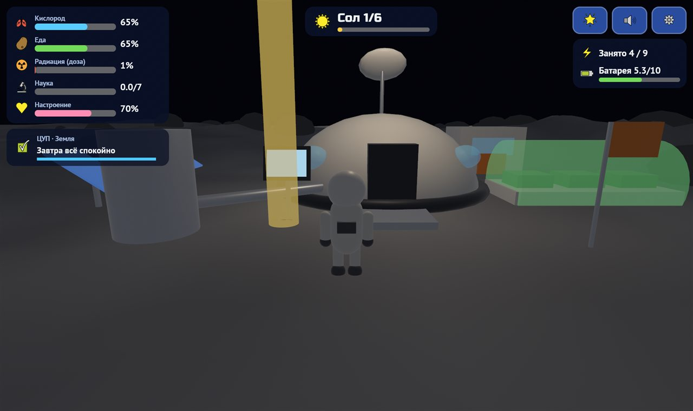

| | | |
|---|---|---|
| 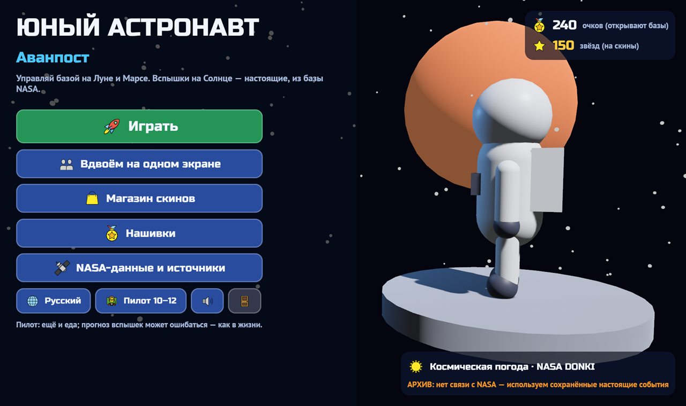 | 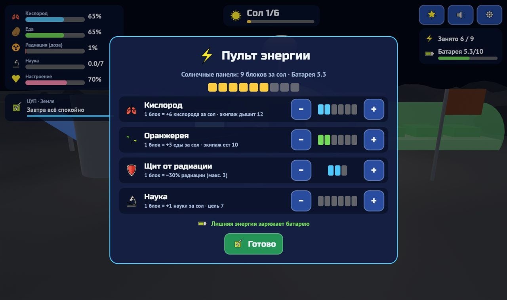 | 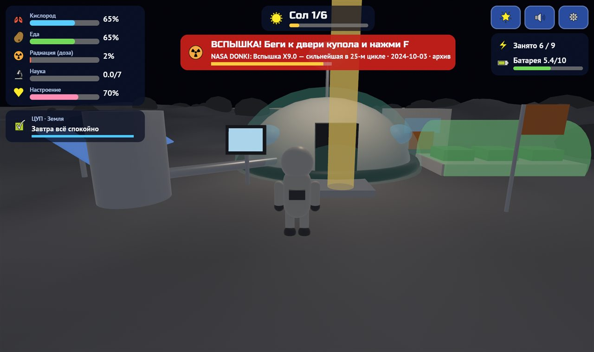 |
| 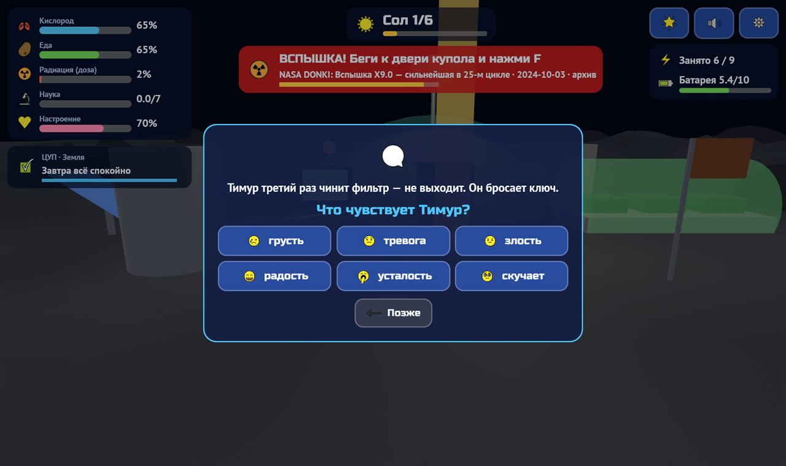 | 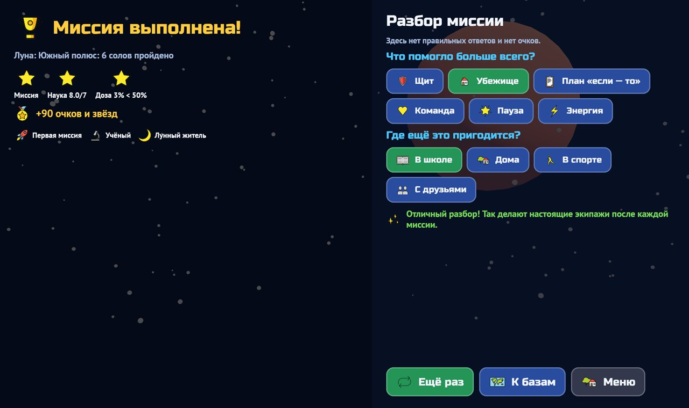 | 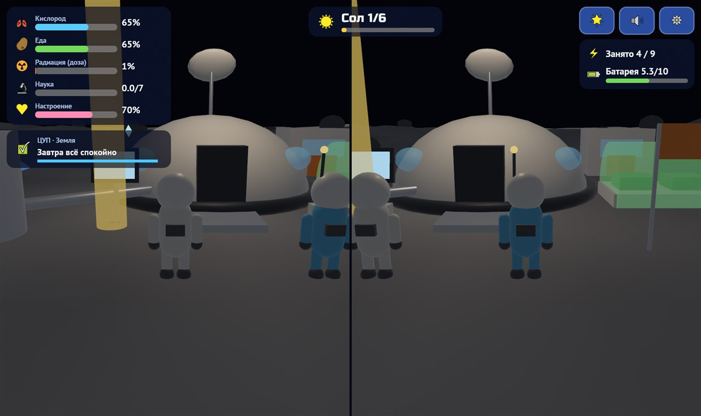 |

## ▶️ How to run / Как запустить

1. Install Rust: https://rustup.rs
2. **Windows:** install [Visual Studio Build Tools](https://visualstudio.microsoft.com/visual-cpp-build-tools/) with the **“Desktop development with C++”** workload (Rust needs its linker).
   **Linux:** `sudo apt install libasound2-dev libudev-dev pkg-config`. **macOS:** `xcode-select --install`.
3. In the project folder:

```bash
cargo run --release
```

The first build takes about 10 minutes (Bevy is big). Later builds are incremental.

**NASA API key (optional):** without a key the game uses `DEMO_KEY`, which allows only ~30 requests per hour per IP. For demos and judging, get a free key at https://api.nasa.gov (1,000 requests/hour) and start the game with it:

```bash
NASA_API_KEY=your_key cargo run --release
```

On Windows PowerShell: `$env:NASA_API_KEY="your_key"; cargo run --release`. With no internet the game uses the embedded DONKI archive and says so on screen.

## 🎮 Controls / Управление

| Action | Player 1 | Player 2 (co-op) | Gamepad |
|---|---|---|---|
| Walk | WASD | arrows | left stick |
| Jump | Space | Right Ctrl | X / Y |
| Action / hold to repair | F or Enter | Right Shift | A |
| Camera | Q / E, or drag the mouse | `,` `.` | right stick |
| Pause, close a window | Esc | — | Start / B |
| Menus | WASD / arrows + Enter, or the mouse | | D-pad + A |

## 🌕 What’s inside / Что есть в игре

- **5 bases:** Desert analog base on Earth → Moon south pole (60 🏅) → Mars, Jezero crater (180 🏅) → Lunar orbit station (400 🏅) → Europa (700 🏅). Each has its own gravity, radiation level, comms delay, day/night and events.
- **Real-time outpost:** a sol lasts 100 seconds. The **power console** splits energy blocks between oxygen, the greenhouse, the radiation shield and the lab. Using more than the sun gives drains the battery.
- **Walk up and act:** hide in the dome during a flare, hold F to repair the oxygen generator, patch a micrometeorite leak or clean dusty panels, harvest the greenhouse, unload a cargo ship, carry glowing samples to the lab.
- **Mission Control** messages arrive after the real comms delay (1.3 s from the Moon; Mars and Europa are sped up and labeled).
- **Crew support:** a crewmate looks sad, angry or worried. The player names the feeling and picks a way to help.
- **Space Beacon:** a voluntary breathing pause. It is never scored and it pauses the game.
- **Debrief** after every mission: what happened, a per-sol oxygen/dose chart, and two reflection questions with no right answers.
- **Two age modes:** *Cadet 7–9* tracks 3 resources and gets accurate forecasts. *Pilot 10–12* adds food, and flare forecasts can be wrong, just like in real life.
- **Split-screen co-op** for two players on one computer (keyboard or two gamepads).
- **Progress:** 🏅 points unlock bases and never go down. ⭐ stars are a separate balance for skins (7 suits, 5 visors, 6 helmet decorations). Buying a skin never relocks a base. 14 mission patches reward actions: sheltering, supporting the crew, trying again.
- **Russian and English**, switchable any time.

## 🛰️ NASA data used and why / Какие данные NASA и зачем

| Dataset | Where in the game | Why |
|---|---|---|
| **DONKI** (FLR, GST, SEP, CME), live via api.nasa.gov | Main-menu space weather panel; every in-game flare names its real event and date, marked *LIVE* or *archive*; the “real weather” switch in the briefing | Links the shielding decision to actual solar activity |
| **Curiosity RAD**: Mars surface 0.64 mSv/day, cruise 1.84 mSv/day (Hassler et al., 2014) | Dose rate on the Mars and Lunar orbit maps | Real radiation ratios between places |
| **Chang’e‑4 LND**: lunar surface 1.369 mSv/day (Zhang et al., 2020) | Dose rate on the Moon map | Shows why the Moon needs more shielding than Mars |
| **NASA Veggie / OSDR** | Greenhouse harvest | Real plant growth in space (ISS lettuce, 2015) |
| **MOXIE** (Perseverance) | Life-support facts | Oxygen made from Mars air |
| **NASA Space Communications** | Mission Control delay | 1.3 s to the Moon, 4–24 min to Mars |
| **NASA-STD-3001**, NASA HRP hazards | Dose limit and mission design | Why dose has a limit |
| **Mars 2018 dust storm**, 29.5-day lunar day | Dust storm and lunar night events | Power drops that really happen |

**Honesty rules in the code:**
- Game numbers are scaled so kids can follow them. Ratios and cause and effect follow the real data.
- Archived data is **never** shown as live. Flares are always labeled *LIVE* or *archive* with their date.
- **No crew deaths.** On failure the crew evacuates safely and the debrief explains why.
- No accounts, no personal data. Progress is a JSON file in the user’s home folder.

## 🧠 Psychology / Психологическая основа

From our research doc (`Trenazher_yunyh_astronavtov.docx`):
- An **if–then plan** in every briefing (“If there is a flare — then I run into the dome”).
- **Pause before acting:** the Space Beacon breathing pause is voluntary and never scored (Obradović et al., 2021).
- **Emotion naming and crew support** with gentle feedback: a wrong guess is “maybe, what else?”, never a penalty.
- **Feedback describes actions** (“took shelter during a flare — done”), not personality.
- **A debrief after every mission:** “what helped?” and “where else is this useful?”, with no scoring.
- Hints are free. There is no public ranking.

## 🏆 How we address the judging criteria

- **Impact:** for kids 7–12, icon-first UI with big buttons, two languages, two age modes, keyboard/gamepad/mouse, and two players on one screen for classrooms and families.
- **Creativity:** a walkable 3D base where real solar flares from NASA drive the events, and a Mission Control radio delayed like real comms.
- **Validity:** dose ratios come from measured data, DONKI events are real and labeled, every source is cited on the in-game “NASA data & sources” page, and the simulation is balance-tested with Monte Carlo runs (below).
- **Relevance:** life support, radiation shielding, power budgeting, food production, communication delay and real NASA open data.
- **Presentation:** a 3D world that reacts to the simulation (shield glow, dusty panels, battery bars, warning lamps, a cargo ship landing), and a screenshot tour for slides.

## 🧪 Balance test

The Monte Carlo harness from the HTML prototype is ported to the Rust simulation (`src/sim.rs`, `mod balance`). It plays 400 missions per base, age mode and player style: a careful kid who reacts in ~9 s and hides from flares, and a careless one who ignores forecasts.

```bash
cargo test --release balance -- --ignored --nocapture
```

Pilot mode (10–12), 400 missions each:

| Base | Careful kid: win % | avg dose | Careless kid: win % | avg dose |
|---|---|---|---|---|
| Earth (tutorial) | 100 | 0 % | 100 | 0 % |
| Moon | 100 | 49 % | 67 | 91 % |
| Mars | 100 | 34 % | 100 | 60 % |
| Lunar orbit | 100 | 42 % | 0 | 100 % |
| Europa | 100 | 47 % | 0 | 100 % |

Careless players only ever lose to radiation, so the shield and the shelter are what matter. Mars is gentler than the Moon because its measured dose is lower. The test also caught that Europa was unwinnable even for a careful player, so its base was moved under the ice (and labeled that way in the briefing).

## 📸 Screenshot tour

Plays through the menu, a Moon mission, the debrief and co-op by itself, saves PNGs and quits. It uses a throwaway profile, so real progress is untouched:

```bash
JA_SHOTS=docs/screenshots JA_PROFILE=docs/screenshots/profile.json cargo run --release
```

## 📁 Files

- `src/main.rs` — app setup, states, UI camera, system order
- `src/data.rs` — maps, DONKI archive, skins, patches, feelings, sources
- `src/sim.rs` — real-time outpost simulation (pure data) and the balance test
- `src/nasa.rs` — live DONKI fetch in a background thread, archive fallback
- `src/world.rs` — terrain, sky, base modules, astronaut model, world reacting to the simulation
- `src/player.rs` — third-person controller, camera, split screen, keyboard/gamepad input
- `src/interact.rs` — walk up and press / hold the action key
- `src/game.rs` — mission start, events → alerts, cargo ship, mission end and rewards
- `src/ui.rs` — HUD, windows (power console, harvest, cargo, crew support, pause, beacon, tutorial), buttons and gamepad navigation
- `src/menu.rs` — main menu with 3D preview, bases, briefing, shop, patches, sources, debrief
- `src/audio.rs`, `src/save.rs`, `src/i18n.rs`, `src/tour.rs`
- `assets/` — OpenMoji icons (CC BY-SA 4.0), Russo One and PT Sans fonts (OFL), generated sound effects

The HTML prototype is kept in git history (commit `46da10d`).

**Status:** the native game is complete. The code also type-checks for `wasm32-unknown-unknown`, but a browser build (wasm-bindgen + a page) and online co-op are not done yet; co-op is split-screen only.

## 🛰️ 2D game and network co-op / 2D-игра и игра по сети

The newer 2D pixel-art version lives in `crates/game` (rules in `crates/core`, see `docs/PLAN_2D.md`). Run it with `cargo run -p game --release`.

**Two laptops on the same Wi‑Fi:** on one, choose **Network → Create a game**, pick a base and launch. On the other, choose **Network** and click the game that appears, or type the host's IP. The second player controls the blue astronaut with their own keyboard or gamepad. If Windows asks about network access, allow it (UDP ports 7777 and 7778). The host runs the rules; the guest mirrors the host's state, so the two computers never drift apart.

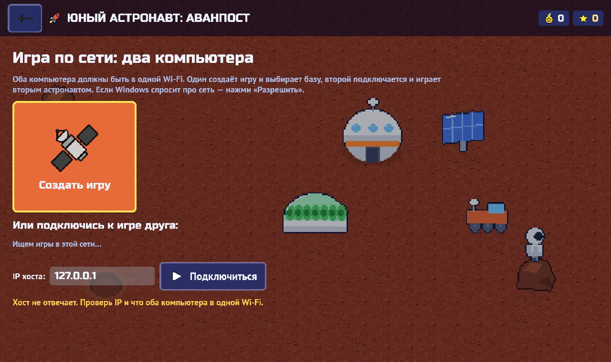

## 🌕 Landing and survival on the Moon / Посадка и выживание на Луне

**Start → New expedition** (Survival or Creative, Junior or Advanced, 1–2 players) → **land the module** near the lunar south pole (W/S thrust, A/D tilt, E answers Mission Control's “1202” alarm) → **survive**: every morning Mission Control sends tonight's forecast (cold snap, dust cloud, meteorites, energy crisis, breakdowns, or a real NASA DONKI flare). Spend coins on upgrades (U) — each one has a trade-off — and read the evening report to see what your choices changed.

**«Начать» → «Новая экспедиция»** (выживание или творческий режим, Junior или Advanced, 1–2 игрока) → **посадка** у южного полюса Луны → **выживание**: утром прогноз на вечер, днём работа и улучшения за монеты (U), вечером угроза, потом разбор «почему так вышло».

**Landing help / Помощь при посадке:** a green pad marks the flattest ground; a live checklist turns each touchdown rule green or red (down speed, sideways speed, tilt, flat ground, where the pad is); near the ground one tip says what to fix. After an abort a table shows “was / needed” for each rule, and **R** or “Try with the helper” starts a new approach (the helper holds the speed and steers to the pad while you don’t press keys). Зелёная площадка, живой чек-лист, разбор «было / нужно» и заход с помощником.

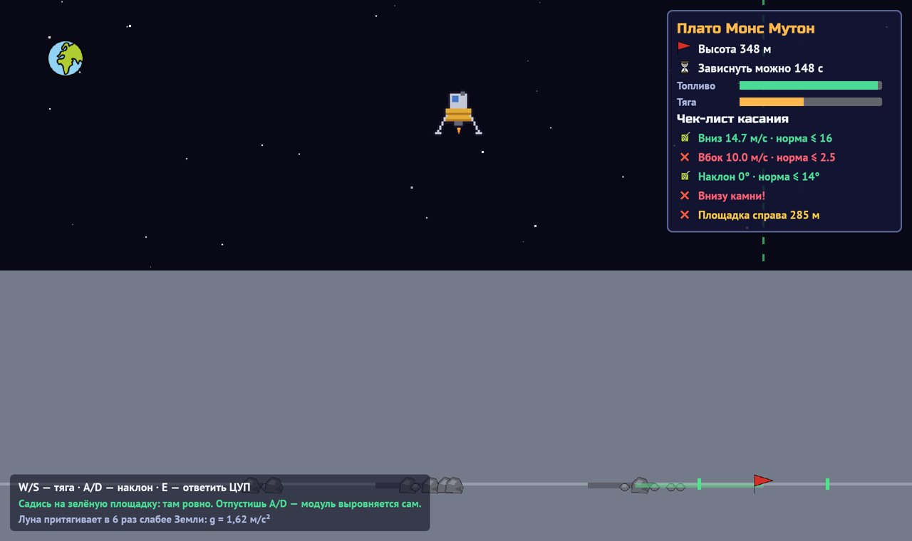
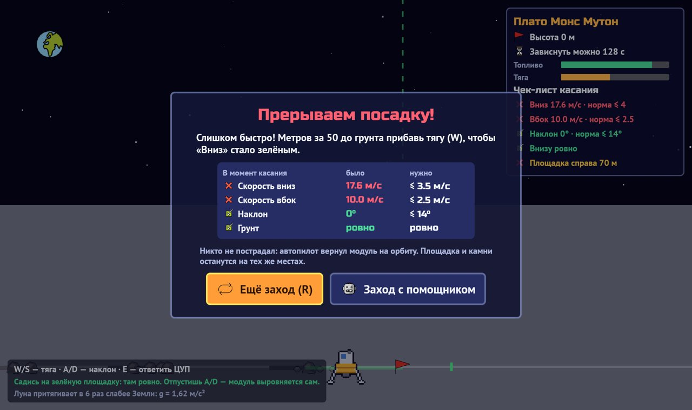
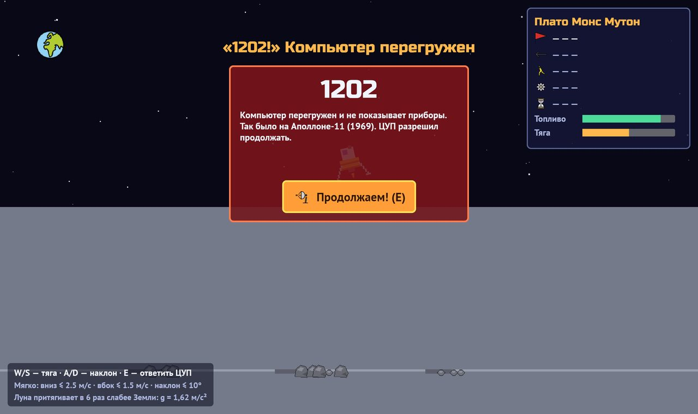
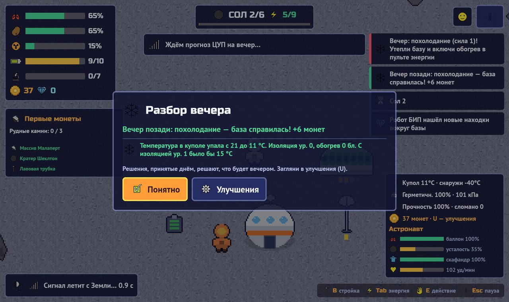

Balance: `cargo test -p ja-core --release survival_balance -- --ignored --nocapture` · screenshot tours: `JA_TOUR=survival` (campaign) and `JA_TOUR=landing` (checklist, abort table, helper) with `JA_SHOTS=folder cargo run -p game --release`.

## 👩‍🚀 Profiles, roles, achievements / Профили, роли, достижения

- **Profiles / Профили** — up to 6 on one computer. The name is a space callsign from a list (Vega‑7, Orion‑4…), so a child never types personal data; everything stays in a local JSON file. Имя — позывной из списка, настоящее имя не нужно.
- **Roles / Роли** — pilot (+20% landing fuel), engineer (repairs ×1.5), researcher (+25% science), life support (suit oxygen lasts 25% longer). A role gives a bonus and forbids nothing.
- **Achievements in 6 directions / Достижения по 6 направлениям** — explorer, engineer, pilot, survival specialist, scientist, team player; bronze / silver / gold from lifetime counters. Each tier gives stars for cosmetics only.
- **Inventory, expedition history, settings** — wear what you own, see past expeditions, switch RU / ҚАЗ / EN, sound, music, fullscreen, touch controls.
- **Touch controls / Сенсорное управление** — a virtual joystick and an action button (also work with a mouse drag); “Auto” shows them after the first touch.
- **Texts / Тексты** — interface texts live in `assets/content/ui.json` (ru / kk / en). Kazakh is partial: where a translation is missing, Russian is shown; `cargo test -p ja-core ui_text -- --nocapture` lists the missing keys.

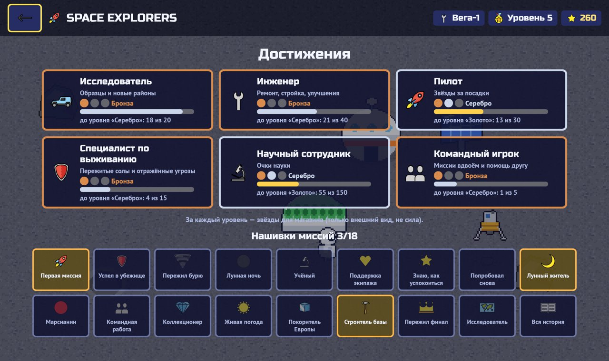
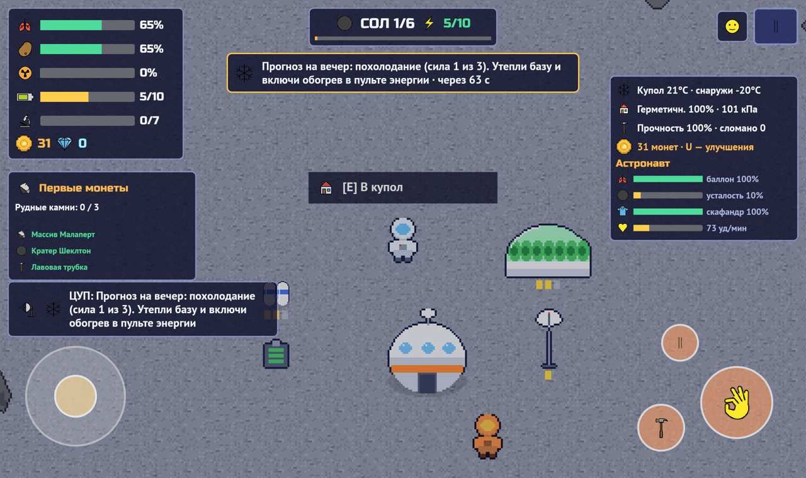

Screenshot tour of these screens: `JA_TOUR=screens JA_SHOTS=folder cargo run -p game --release`.

*Educational game. It does not assess readiness for real spaceflight and is not psychological treatment.*
